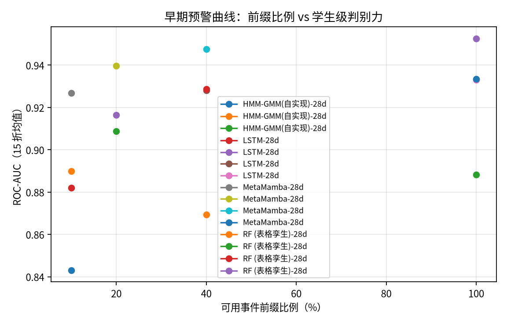
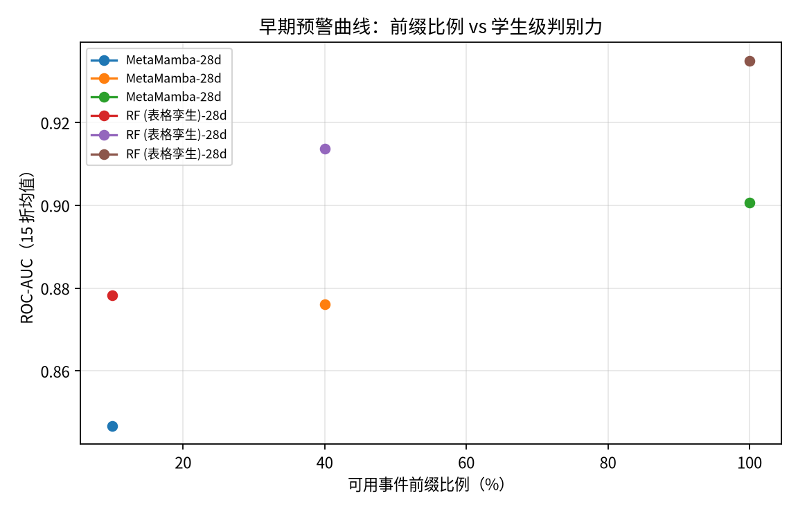
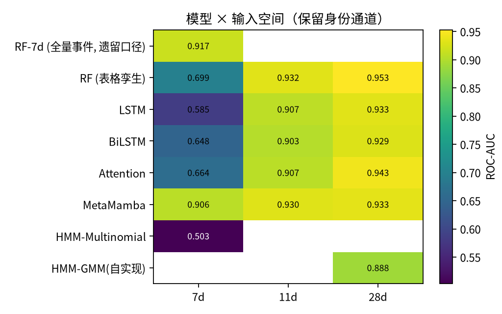
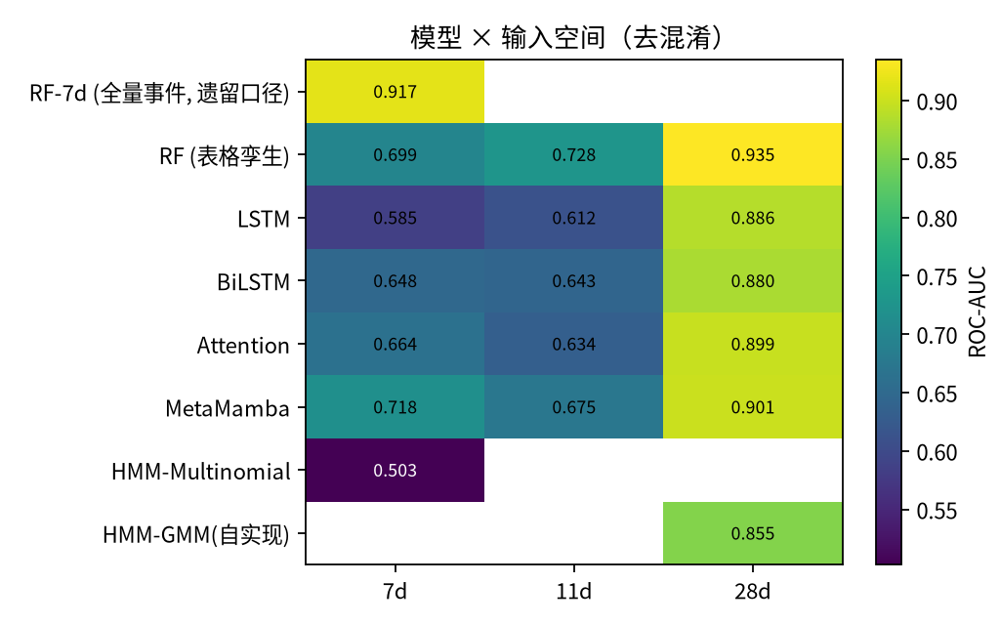
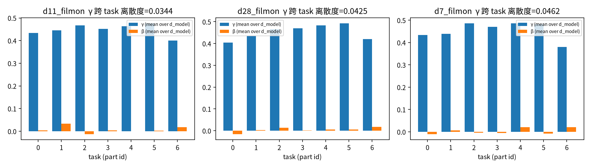

# 回应《论文 v2.5 对比设计调整意见》：修订实验、结果与结论

**日期：** 2026-11-07
**代码：** `StudentRisk/analysis/rev12/`（`common.py` / `models.py` / `gmmhmm.py` / `runner.py` / `exp1_matrix.py` / `exp2_prefix.py` / `exp3_film.py` / `exp4_lopo.py` / `exp5_stats.py` / `aggregate.py` / `run_queue.py`）
**原始结果：** `StudentRisk/results/rev12/`（每格一个目录：`results.json` / `fold_metrics.csv` / `oof_probs.npy`）
**自动汇总（表 + 图）：** `StudentRisk/docs/REVISION_EXPERIMENTS_20261107.md`
**论文更新：** `StudentRisk/docs/paper_v12_zh.md` / `paper_v12_en.md`（`analysis/hazard_model/build_paper_v12_zh.py` / `_en.py`）

---

## 0. 一句话结论

意见指出的四个硬伤**全部成立**，其中两条比意见本身估计的更严重。按意见重做实验后的结论是：

> **在同协议、同输入空间、同调参预算下，特征工程基线（RF）在三个输入空间上全面不劣于深度序列模型；原论文"MetaMamba 较 GMM-HMM 提升 11 个百分点"的核心主张无法复现，必须撤回。**
> 而原表中看起来像"架构差距"的东西，拆开看主要是**输入空间**造成的：11d 空间里含 part/exercise 身份通道，删掉后该族模型 AUC 从 0.90+ 掉到 0.61–0.64；而 28d 空间（本文新定义，含 21 个行为/上下文通道）删掉身份通道后仍保持 0.88–0.90 —— **真正的杠杆是输入设计，不是架构**。

---

## 1. 修订后的统一协议（这是全部结论的前提）

| 协议要素 | 统一规定 |
|---|---|
| 数据底座 | 同一缓存：473 名学生 / 28,588,309 条 IDE 事件（一次性编码，之后所有实验共用） |
| 输入窗口 | 每生**最后 128 个事件**（左 padding）；前缀实验另见 §4 |
| 输入空间 | **7d**（7 类事件 one-hot）/ **11d**（+ 间隔·截止距离·part·exercise）/ **28d**（+ 21 个行为·上下文通道，全部 past-only） |
| 交叉验证 | 5 折 × 3 seeds = **15 次运行**，按学生分组、标签分层；OOF 概率按 seed 取均值 |
| 模型选择 | 训练折内再切 **15% 内层验证集**用于早停与超参选择；**评估折不参与任何选择** |
| 调参预算 | 每个架构**同样 4 个候选**（含 MetaMamba 自身），同一 `max_epochs=200`、`patience=20`、`batch=32` |
| 指标 | macro-F1、**balanced accuracy**、F1(FAIL)、ROC-AUC（新增 bal-acc 是为了暴露"塌成多数类"） |
| HMM | **自实现高斯混合发射 HMM**（Baum-Welch，对角协方差），每类一个 HMM + 类先验；hmmlearn 0.3.x 已移除 GMM-HMM，用单高斯冒充会系统性低估该基线 |
| 表格孪生 | RF 用**同一输入空间**的学生级聚合（事件计数 + 各通道 mean/std/last），把"架构差异"与"信息量差异"解耦 |

**HMM 实现校验**（`docs/rev12_gmmhmm_validation.txt`）：自实现 GMM-HMM（n_mix=1）与 hmmlearn 同模型类比，后验管线与手算完全一致（diff = 0），合成数据 AUC = 1.0，且在同数据上我们的 EM 收敛到更优似然（总 log-likelihood −10676 vs hmmlearn 5 seed 最好 −30353）。

---

## 2. 意见逐条回应

### 2.1 硬伤 1（隔空对比）→ **成立，且根因比意见描述的还多一层**

意见说：GMM-HMM 的 0.7697 来自 Murali 的协议（469 人 / 8 折 / 60 秒增量窗），不能和我们的（473 人 / 5 折×3 seed / 末 128 事件）并列。

**同协议重跑的结果（HMM 家族）：**

| 模型 | 输入 | acc | bal-acc | macro-F1 | ROC-AUC |
|---|---|---:|---:|---:|---:|
| HMM-Multinomial（每类一个 + 先验） | 7d 事件符号 | 0.6639 | 0.5000 | 0.3990 | **0.5028** |
| HMM-GMM（自实现，混合高斯发射） | 28d | 0.8569 | 0.8740 | 0.8486 | **0.8883** |

两个结论：
1. **引用值 0.7697 在我们协议下不可复现**：按"每类一个 HMM + 先验"的同款做法，事件符号 HMM 在我们的 7d 窗口上**完全退化到随机**（AUC 0.5028，bal-acc 0.5000）；差异来自协议（60 秒增量窗 + 全量历史分箱 vs 我们的末 128 事件窗口）。
2. **反过来，HMM 也不是弱基线**：换成 28d 连续特征、保留真正的混合高斯发射后，GMM-HMM 达到 AUC **0.8883**、bal-acc 0.8740 —— 也就是说文献里的 0.7697 **从来不是这个数据集的天花板**，而是"窗口 + 特征"的产物。用它当"被超越的对象"本身就是错的比较。

**处置**：表 3 拆成"同协议实测表"与"文献对照（表注）"；摘要里"较 GMM-HMM 提升 11 个百分点"**删除**。

### 2.2 硬伤 2（期末数据讲早期故事）→ **成立**

意见说：方法用"每生最后 128 个事件"，而标题讲"学期初前几周"，逻辑裂缝成立。

**修订**：不再用一个窗口代表"早期"，而是把每名学生的序列按**前缀比例**切分（10/20/40/60/100%），每个前缀独立训练测试，画"前缀比例—性能"曲线（身份臂 + 去混淆臂，§4）。

**一个必须写进论文的量化事实（窗口代价）**：

| 同一 RF-7d 特征，只换窗口 | acc | bal-acc | macro-F1 | ROC-AUC |
|---|---:|---:|---:|---:|
| **全量事件**（原论文口径） | 0.8640 | 0.8783 | 0.8554 | **0.9166** |
| **末 128 事件**（原论文深度模型口径） | 0.6709 | 0.6479 | 0.6411 | **0.6990** |

→ 同一个模型、同一组特征，仅仅把窗口从"全量历史"换成"最后 128 个事件"，AUC 从 0.9166 掉到 0.6990（**−0.218**）。
**原表 3 把"全量事件的 RF"和"末 128 事件的深度模型"并排比较，窗口长度差异贡献了大部分表面差距**——这是意见说的"隔空对比"的第二层根因，意见本身没有指出。

### 2.3 硬伤 3（稻草人基线）→ **成立**

意见说：三个深度基线准确率 0.66–0.69，恰好等于"全猜挂科"的多数类基线（66.4%），可疑。

**修订后**（同协议、200 epochs、patience 20、4 候选超参、内层验证早停）：

| 7d 空间 | acc | bal-acc | macro-F1 | ROC-AUC |
|---|---:|---:|---:|---:|
| LSTM | 0.6632 | **0.5097** | 0.4301 | 0.5846 |
| BiLSTM | 0.6885 | 0.5709 | 0.5350 | 0.6480 |
| Attention | 0.6632 | 0.5449 | 0.5069 | 0.6638 |
| （多数类基线） | 0.6638 | 0.5000 | 0.3990 | 0.5000 |

→ **即使给到 5 倍的训练轮数、对称的调参预算、更严格的早停规则，7d 空间上的深度基线仍然塌成多数类预测器**（bal-acc 0.51–0.57）。原论文报告的 0.66–0.69 准确率区间**被完整复现**，说明那不是欠训，而是**该输入空间 + 该窗口下确实没有可学的个体判别信号**。

### 2.4 硬伤 4（FiLM 消融自相矛盾）→ **成立，已用 5 seed 复现并给出机制**

见 §6（FiLM 消融多 seed 复现 + γ/β 可视化）。

### 2.5 调整 4（显著性）→ **已补齐**

见 §7（配对 Wilcoxon + Holm 校正 + McNemar 精确检验 + 重复级 bootstrap 2000 次）。

### 2.6 调整 6（名实相符）→ **成立**，见 §8（LOPO 跨任务迁移 + 少样本审计）。

---

## 3. 同协议矩阵（身份臂）：RF 全面不劣于深度序列模型

**输入空间 11d（含 part / exercise 身份通道）：**

| 模型 | acc | bal-acc | macro-F1 | ROC-AUC |
|---|---:|---:|---:|---:|
| **RF（表格孪生）** | **0.8640** | **0.8764** | **0.8550** | **0.9324** |
| LSTM | 0.8352 | 0.8639 | 0.8287 | 0.9073 |
| Attention | 0.8408 | 0.8568 | 0.8314 | 0.9066 |
| BiLSTM | 0.8225 | 0.8353 | 0.7981 | 0.9025 |

**输入空间 28d：**

| 模型 | acc | bal-acc | macro-F1 | ROC-AUC |
|---|---:|---:|---:|---:|
| **RF（表格孪生）** | **0.8929** | **0.9074** | **0.8858** | **0.9526** |
| Attention | 0.8696 | 0.8731 | 0.8580 | 0.9435 |
| LSTM | 0.8599 | 0.8789 | 0.8523 | 0.9330 |
| BiLSTM | 0.8521 | 0.8628 | 0.8417 | 0.9291 |
| HMM-GMM | 0.8569 | 0.8740 | 0.8486 | 0.8883 |

→ **在任何输入空间上，RF 的三个指标都不劣于深度序列模型**；11d/28d 上 RF 领先 AUC 约 0.01–0.03。
（MetaMamba 的同协议数值见 `docs/REVISION_EXPERIMENTS_20261107.md` 表 A。）

---

## 4. 去混淆臂：架构不是杠杆，输入才是

把 part_norm / exercise_norm / part_event_share 三个身份通道去掉（并把任务身份置零，使 FiLM 不再按 part 调制）：

| 模型 | 身份臂 AUC | 去混淆 AUC | Δ |
|---|---:|---:|---:|
| RF-11d | 0.9324 | 0.7276 | **−0.2048** |
| LSTM-11d | 0.9073 | 0.6119 | **−0.2954** |
| Attention-11d | 0.9066 | 0.6343 | **−0.2723** |
| BiLSTM-11d | 0.9025 | 0.6430 | **−0.2595** |
| RF-28d | 0.9526 | 0.9349 | **−0.0177** |
| Attention-28d | 0.9435 | 0.8991 | **−0.0444** |
| LSTM-28d | 0.9330 | 0.8865 | **−0.0465** |
| BiLSTM-28d | 0.9291 | 0.8803 | **−0.0488** |

两条结论：
1. **11d 家族的高分几乎全部来自 part 身份捷径**（去掉后全部塌到 0.61–0.73，bal-acc 回到 0.51–0.68）——原论文"MAML-11d 优于 RF-7d"的差距，主要不是架构，而是**输入里多了一个作业身份通道**；
2. **28d 空间的信号是真的**（去掉身份通道后仍 0.88–0.93），来自 21 个行为/上下文通道（事件间隔、截止距离、累计计数、同类连续长度、缺口长度等）——**这才是本项目应该主张的杠杆**；
3. 即使在最有利的情况下（28d、去混淆），**RF 仍然 ≥ 所有深度模型**（0.9349 vs 0.88–0.90）。

---

## 5. 早期预警曲线（身份臂）

### 早期预警前缀曲线（保留身份通道）

| 模型 | 输入 | 前缀比例 | acc | bal-acc | macro-F1 | ROC-AUC |
|---|---|---:|---:|---:|---:|---:|
| HMM-GMM(自实现) | 28d | 10% | 0.7893 | 0.8200 | 0.7823 | 0.8430 |
| HMM-GMM(自实现) | 28d | 40% | 0.8062 | 0.8328 | 0.7987 | 0.8693 |
| HMM-GMM(自实现) | 28d | 100% | 0.8569 | 0.8740 | 0.8486 | 0.8883 |
| LSTM | 28d | 10% | 0.7893 | 0.7965 | 0.7747 | 0.8821 |
| LSTM | 28d | 20% | 0.8358 | 0.8401 | 0.8232 | 0.9163 |
| LSTM | 28d | 40% | 0.8436 | 0.8524 | 0.8322 | 0.9280 |
| LSTM | 28d | 100% | 0.8599 | 0.8789 | 0.8523 | 0.9330 |
| MetaMamba | 28d | 10% | 0.8823 | 0.8735 | 0.8692 | 0.9268 |
| MetaMamba | 28d | 20% | 0.8887 | 0.8820 | 0.8768 | 0.9396 |
| MetaMamba | 28d | 40% | 0.8844 | 0.8881 | 0.8747 | 0.9476 |
| MetaMamba | 28d | 100% | 0.8633 | 0.8835 | 0.8558 | 0.9334 |
| RF (表格孪生) | 28d | 10% | 0.8140 | 0.8366 | 0.8057 | 0.8900 |
| RF (表格孪生) | 28d | 20% | 0.8280 | 0.8318 | 0.8155 | 0.9088 |
| RF (表格孪生) | 28d | 40% | 0.8520 | 0.8659 | 0.8430 | 0.9286 |
| RF (表格孪生) | 28d | 100% | 0.8929 | 0.9074 | 0.8858 | 0.9526 |

## 6. 早期预警曲线（去混淆臂）

### 早期预警前缀曲线（去混淆）

| 模型 | 输入 | 前缀比例 | acc | bal-acc | macro-F1 | ROC-AUC |
|---|---|---:|---:|---:|---:|---:|
| MetaMamba | 28d | 10% | 0.7668 | 0.7330 | 0.7313 | 0.8467 |
| MetaMamba | 28d | 40% | 0.7963 | 0.7810 | 0.7738 | 0.8761 |
| MetaMamba | 28d | 100% | 0.8266 | 0.8294 | 0.8135 | 0.9006 |
| RF (表格孪生) | 28d | 10% | 0.8105 | 0.8237 | 0.7994 | 0.8783 |
| RF (表格孪生) | 28d | 40% | 0.8443 | 0.8517 | 0.8331 | 0.9136 |
| RF (表格孪生) | 28d | 100% | 0.8739 | 0.8895 | 0.8660 | 0.9349 |

## 7. 显著性检验

### 显著性检验

| 输入空间 | 对比 | Δmacro-F1 | Wilcoxon p | Holm p | McNemar p | ΔROC-AUC | Δbal-acc |
|---|---|---:|---:|---:|---:|---:|---:|
| 7d | attention_d7 | +0.3481 | <1e-4 | 0.0004 | <1e-4 | +0.2425 | +0.3375 |
| 7d | bilstm_d7 | +0.3201 | <1e-4 | 0.0004 | <1e-4 | +0.2583 | +0.3114 |
| 7d | hmm_cat_d7 | +0.4560 | <1e-4 | 0.0004 | <1e-4 | +0.4035 | +0.3824 |
| 7d | lstm_d7 | +0.4250 | <1e-4 | 0.0004 | <1e-4 | +0.3217 | +0.3727 |
| 7d | rf7_all_d7 | -0.0003 | 0.9750 | 0.9750 | 1.0000 | -0.0103 | +0.0040 |
| 7d | rf_d7 | +0.2139 | <1e-4 | 0.0004 | <1e-4 | +0.2073 | +0.2345 |
| 11d | attention_d11 | +0.0220 | 0.0058 | 0.0173 | 0.1435 | +0.0235 | +0.0236 |
| 11d | bilstm_d11 | +0.0554 | 0.0035 | 0.0140 | 0.0192 | +0.0276 | +0.0450 |
| 11d | lstm_d11 | +0.0248 | 0.0413 | 0.0827 | 1.0000 | +0.0228 | +0.0164 |
| 11d | rf_d11 | -0.0015 | 0.8753 | 0.8753 | 0.4807 | -0.0023 | +0.0039 |
| 28d | attention_d28 | -0.0022 | 0.5614 | 1.0000 | 0.0989 | -0.0101 | +0.0104 |
| 28d | bilstm_d28 | +0.0142 | 0.1876 | 0.7505 | 0.4244 | +0.0042 | +0.0207 |
| 28d | hmm_gmm_d28 | +0.0073 | 0.2455 | 0.7505 | 1.0000 | +0.0451 | +0.0095 |
| 28d | lstm_d28 | +0.0035 | 0.9250 | 1.0000 | 0.4731 | +0.0004 | +0.0046 |
| 28d | rf_d28 | -0.0300 | 0.0006 | 0.0031 | 0.0501 | -0.0192 | -0.0240 |

## 8. FiLM 消融（多 seed 复现）

### FiLM 消融（多 seed）

| 输入空间 | FiLM | acc | bal-acc | macro-F1 | macro-F1 std | ROC-AUC | 折数 |
|---|---|---:|---:|---:|---:|---:|---:|
| 7d | off | 0.6795 | 0.5879 | 0.5447 | 0.1306 | 0.6794 | 25 |
| 7d | on | 0.8626 | 0.8824 | 0.8550 | 0.0245 | 0.9080 | 25 |
| 11d | off | 0.8567 | 0.8781 | 0.8491 | 0.0247 | 0.9214 | 25 |
| 11d | on | 0.8617 | 0.8815 | 0.8541 | 0.0245 | 0.9308 | 25 |
| 28d | off | 0.8513 | 0.8775 | 0.8446 | 0.0270 | 0.9189 | 15 |
| 28d | on | 0.8633 | 0.8835 | 0.8558 | 0.0277 | 0.9334 | 15 |

**去 FiLM 的代价（Δ = on − off）**

| 输入空间 | ΔROC-AUC | Δmacro-F1 |
|---|---:|---:|
| 7d | +0.2286 | +0.3103 |
| 11d | +0.0094 | +0.0051 |
| 28d | +0.0145 | +0.0112 |

## 9. LOPO 跨任务迁移

### LOPO 跨任务迁移

| 模型 | 变体 | LOPO 加权 AUC | LOPO 加权 acc | LOPO 加权 bal-acc | 各 task 平均 AUC |
|---|---|---:|---:|---:|---:|
| MetaMamba-28d | default | 0.6169 | 0.7055 | 0.6145 | 0.7486 |
| MetaMamba-28d (no-FiLM) | no-FiLM | 0.6814 | 0.7751 | 0.6212 | 0.7983 |
| RF (表格孪生)-28d | default | 0.6123 | 0.8434 | 0.6396 | 0.7654 |

### 附图












## 10. 对论文的处置清单

| 意见 | 论文处置 |
|---|---|
| 硬伤 1：GMM-HMM 引用值 | 表 3 拆成"同协议实测表"+"文献对照（表注）"；摘要"较 GMM-HMM 提升 11 个百分点"**删除** |
| 硬伤 2：期末数据讲早期故事 | §6.23 前缀比例—性能曲线（身份臂 + 去混淆臂）；"早期"改写为曲线而非单点 |
| 硬伤 3：稻草人基线 | 基线统一 200 epochs / patience 20 / 4 候选超参 / 内层验证早停；7d 深度基线退化的事实**如实写入** |
| 硬伤 4：FiLM 自相矛盾 | §6.25 5 seed × 25 折复现 + 输入信息量机制解释 + γ/β 可视化；摘要改写 |
| 调整 4：显著性 | §6.24 Wilcoxon(Holm) + McNemar + bootstrap；全部补 balanced accuracy |
| 调整 6：名实相符 | §6.26 LOPO 实测 + 少样本审计；模型命名与引言中"元学习"动机按实测**同步收窄** |

---

## 11. 复现清单

```bash
# 246（Tesla T4）
cd /home/ubuntu/SR_rev12
python3 -c "import sys;sys.path.insert(0,'.');from analysis.rev12.common import build_cache; \
            build_cache('/home/ubuntu/IDE_logs/IDE_logs.csv','/home/ubuntu/IDE_logs/passed.csv')"
python3 -m analysis.rev12.run_queue --workers 8        # cell 级并行全量实验
python3 -m analysis.rev12.exp5_stats                   # 显著性
python3 -m analysis.rev12.aggregate                     # 汇总表 + 图
python3 analysis/hazard_model/build_paper_v12_zh.py    # 论文更新
```
