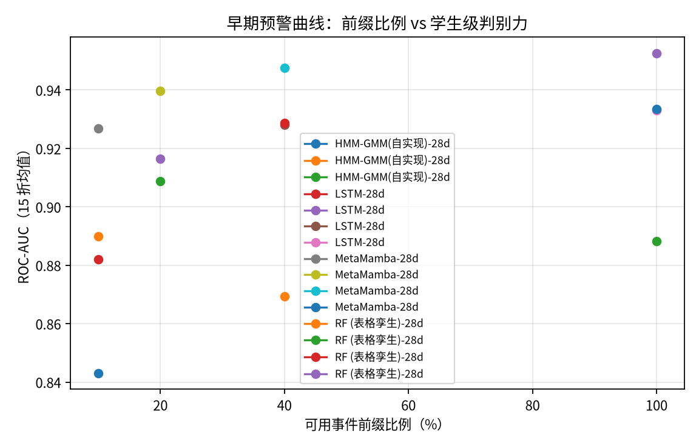
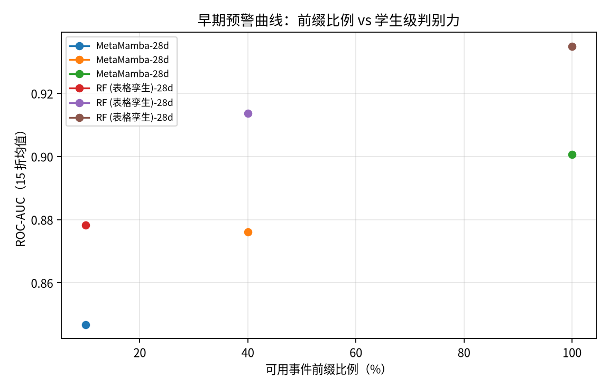
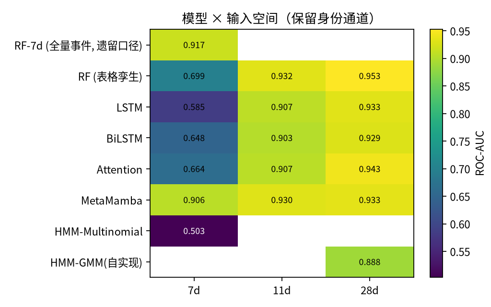
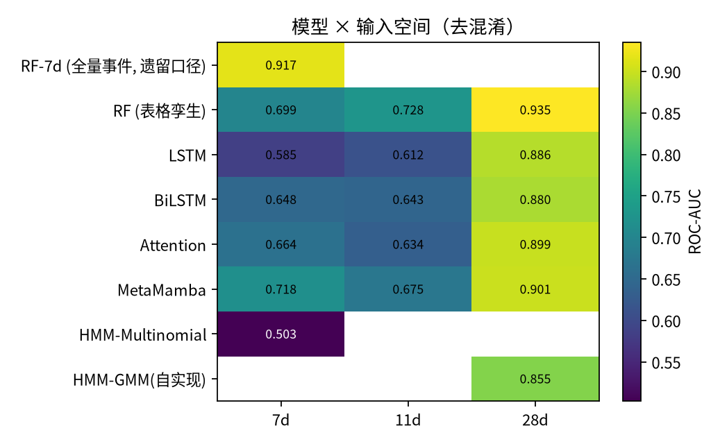
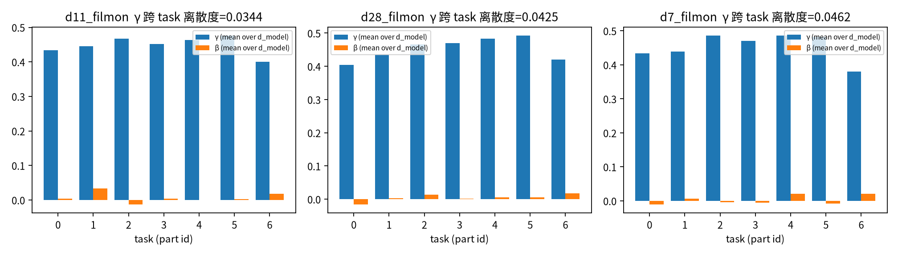

# 论文 v2.5 对比设计修订实验结果（rev12）

生成时间：2026-11-08 03:17

本文件由 `analysis/rev12/aggregate.py` 自动汇总；原始结果见 `results/rev12/`。

## 1. 模型 × 输入空间矩阵（同协议重跑）

**表 A：模型 × 输入空间（保留 part/exercise 身份通道，与论文 v2.5 学生级协议一致）**

| 输入空间 | 模型 | acc | **bal-acc** | macro-F1 | macro-F1 std | F1(FAIL) | ROC-AUC | AUC std |
|---|---|---:|---:|---:|---:|---:|---:|---:|
| 7d | Attention | 0.6632 | 0.5449 | 0.5069 | 0.0835 | 0.7805 | 0.6638 | 0.0482 |
| 7d | BiLSTM | 0.6885 | 0.5709 | 0.5350 | 0.1076 | 0.7985 | 0.6480 | 0.0866 |
| 7d | HMM-Multinomial | 0.6639 | 0.5000 | 0.3990 | 0.0013 | 0.7980 | 0.5028 | 0.0258 |
| 7d | LSTM | 0.6632 | 0.5097 | 0.4301 | 0.0524 | 0.7939 | 0.5846 | 0.0618 |
| 7d | MetaMamba | 0.8626 | 0.8824 | 0.8550 | 0.0266 | 0.8878 | 0.9063 | 0.0194 |
| 7d | RF (表格孪生) | 0.6709 | 0.6479 | 0.6411 | 0.0394 | 0.7416 | 0.6990 | 0.0556 |
| 7d | RF-7d (全量事件, 遗留口径) | 0.8640 | 0.8783 | 0.8554 | 0.0340 | 0.8903 | 0.9166 | 0.0206 |
| 11d | Attention | 0.8408 | 0.8568 | 0.8314 | 0.0329 | 0.8703 | 0.9066 | 0.0295 |
| 11d | BiLSTM | 0.8225 | 0.8353 | 0.7981 | 0.1144 | 0.8567 | 0.9025 | 0.0317 |
| 11d | LSTM | 0.8352 | 0.8639 | 0.8287 | 0.0350 | 0.8607 | 0.9073 | 0.0363 |
| 11d | MetaMamba | 0.8612 | 0.8803 | 0.8534 | 0.0265 | 0.8868 | 0.9301 | 0.0229 |
| 11d | RF (表格孪生) | 0.8640 | 0.8764 | 0.8550 | 0.0304 | 0.8909 | 0.9324 | 0.0235 |
| 28d | Attention | 0.8696 | 0.8731 | 0.8580 | 0.0322 | 0.8975 | 0.9435 | 0.0235 |
| 28d | BiLSTM | 0.8521 | 0.8628 | 0.8417 | 0.0283 | 0.8808 | 0.9291 | 0.0226 |
| 28d | HMM-GMM(自实现) | 0.8569 | 0.8740 | 0.8486 | 0.0354 | 0.8836 | 0.8883 | 0.0302 |
| 28d | LSTM | 0.8599 | 0.8789 | 0.8523 | 0.0399 | 0.8843 | 0.9330 | 0.0289 |
| 28d | MetaMamba | 0.8633 | 0.8835 | 0.8558 | 0.0277 | 0.8883 | 0.9334 | 0.0251 |
| 28d | RF (表格孪生) | 0.8929 | 0.9074 | 0.8858 | 0.0323 | 0.9140 | 0.9526 | 0.0209 |

## 2. 去混淆矩阵（去掉 part / exercise 身份通道）

**表 B：模型 × 输入空间（去掉 part/exercise 身份通道 = 去混淆臂）**

| 输入空间 | 模型 | acc | **bal-acc** | macro-F1 | macro-F1 std | F1(FAIL) | ROC-AUC | AUC std |
|---|---|---:|---:|---:|---:|---:|---:|---:|
| 7d | Attention | 0.6624 | 0.5434 | 0.5046 | 0.0807 | 0.7801 | 0.6635 | 0.0465 |
| 7d | BiLSTM | 0.6885 | 0.5709 | 0.5350 | 0.1076 | 0.7985 | 0.6480 | 0.0866 |
| 7d | HMM-Multinomial | 0.6639 | 0.5000 | 0.3990 | 0.0013 | 0.7980 | 0.5028 | 0.0258 |
| 7d | LSTM | 0.6632 | 0.5097 | 0.4301 | 0.0524 | 0.7939 | 0.5846 | 0.0618 |
| 7d | MetaMamba | 0.7047 | 0.6237 | 0.6036 | 0.1209 | 0.7955 | 0.7184 | 0.0827 |
| 7d | RF (表格孪生) | 0.6709 | 0.6479 | 0.6411 | 0.0394 | 0.7416 | 0.6990 | 0.0556 |
| 7d | RF-7d (全量事件, 遗留口径) | 0.8640 | 0.8783 | 0.8554 | 0.0340 | 0.8903 | 0.9166 | 0.0206 |
| 11d | Attention | 0.6567 | 0.5471 | 0.5077 | 0.0880 | 0.7701 | 0.6343 | 0.0560 |
| 11d | BiLSTM | 0.6589 | 0.5254 | 0.4632 | 0.0869 | 0.7826 | 0.6430 | 0.0740 |
| 11d | LSTM | 0.6660 | 0.5161 | 0.4428 | 0.0652 | 0.7946 | 0.6119 | 0.0660 |
| 11d | MetaMamba | 0.6786 | 0.5879 | 0.5535 | 0.1306 | 0.7801 | 0.6747 | 0.0952 |
| 11d | RF (表格孪生) | 0.6836 | 0.6792 | 0.6641 | 0.0546 | 0.7436 | 0.7276 | 0.0527 |
| 28d | Attention | 0.8358 | 0.8442 | 0.8243 | 0.0354 | 0.8685 | 0.8991 | 0.0291 |
| 28d | BiLSTM | 0.8090 | 0.8291 | 0.7995 | 0.0342 | 0.8409 | 0.8803 | 0.0262 |
| 28d | HMM-GMM(自实现) | 0.7949 | 0.8238 | 0.7878 | 0.0436 | 0.8252 | 0.8551 | 0.0389 |
| 28d | LSTM | 0.8203 | 0.8425 | 0.8114 | 0.0364 | 0.8509 | 0.8865 | 0.0274 |
| 28d | MetaMamba | 0.8266 | 0.8294 | 0.8135 | 0.0353 | 0.8620 | 0.9006 | 0.0260 |
| 28d | RF (表格孪生) | 0.8739 | 0.8895 | 0.8660 | 0.0292 | 0.8982 | 0.9349 | 0.0257 |

## 3. 早期预警前缀曲线（保留身份通道）

| 模型 | 输入 | 前缀比例 | acc | bal-acc | macro-F1 | ROC-AUC |
|---|---|---:|---:|---:|---:|---:|
| HMM-GMM(自实现) | 28d | 10% | 0.7893 | 0.8200 | 0.7823 | 0.8430 |
| HMM-GMM(自实现) | 28d | 40% | 0.8062 | 0.8328 | 0.7987 | 0.8693 |
| HMM-GMM(自实现) | 28d | 100% | 0.8569 | 0.8740 | 0.8486 | 0.8883 |
| LSTM | 28d | 10% | 0.7893 | 0.7965 | 0.7747 | 0.8821 |
| LSTM | 28d | 20% | 0.8358 | 0.8401 | 0.8232 | 0.9163 |
| LSTM | 28d | 40% | 0.8436 | 0.8524 | 0.8322 | 0.9280 |
| LSTM | 28d | 100% | 0.8599 | 0.8789 | 0.8523 | 0.9330 |
| MetaMamba | 28d | 10% | 0.8823 | 0.8735 | 0.8692 | 0.9268 |
| MetaMamba | 28d | 20% | 0.8887 | 0.8820 | 0.8768 | 0.9396 |
| MetaMamba | 28d | 40% | 0.8844 | 0.8881 | 0.8747 | 0.9476 |
| MetaMamba | 28d | 100% | 0.8633 | 0.8835 | 0.8558 | 0.9334 |
| RF (表格孪生) | 28d | 10% | 0.8140 | 0.8366 | 0.8057 | 0.8900 |
| RF (表格孪生) | 28d | 20% | 0.8280 | 0.8318 | 0.8155 | 0.9088 |
| RF (表格孪生) | 28d | 40% | 0.8520 | 0.8659 | 0.8430 | 0.9286 |
| RF (表格孪生) | 28d | 100% | 0.8929 | 0.9074 | 0.8858 | 0.9526 |

## 4. 早期预警前缀曲线（去混淆）

| 模型 | 输入 | 前缀比例 | acc | bal-acc | macro-F1 | ROC-AUC |
|---|---|---:|---:|---:|---:|---:|
| MetaMamba | 28d | 10% | 0.7668 | 0.7330 | 0.7313 | 0.8467 |
| MetaMamba | 28d | 40% | 0.7963 | 0.7810 | 0.7738 | 0.8761 |
| MetaMamba | 28d | 100% | 0.8266 | 0.8294 | 0.8135 | 0.9006 |
| RF (表格孪生) | 28d | 10% | 0.8105 | 0.8237 | 0.7994 | 0.8783 |
| RF (表格孪生) | 28d | 40% | 0.8443 | 0.8517 | 0.8331 | 0.9136 |
| RF (表格孪生) | 28d | 100% | 0.8739 | 0.8895 | 0.8660 | 0.9349 |

## 5. FiLM 消融（多 seed）

| 输入空间 | FiLM | acc | bal-acc | macro-F1 | macro-F1 std | ROC-AUC | 折数 |
|---|---|---:|---:|---:|---:|---:|---:|
| 7d | off | 0.6795 | 0.5879 | 0.5447 | 0.1306 | 0.6794 | 25 |
| 7d | on | 0.8626 | 0.8824 | 0.8550 | 0.0245 | 0.9080 | 25 |
| 11d | off | 0.8567 | 0.8781 | 0.8491 | 0.0247 | 0.9214 | 25 |
| 11d | on | 0.8617 | 0.8815 | 0.8541 | 0.0245 | 0.9308 | 25 |
| 28d | off | 0.8513 | 0.8775 | 0.8446 | 0.0270 | 0.9189 | 15 |
| 28d | on | 0.8633 | 0.8835 | 0.8558 | 0.0277 | 0.9334 | 15 |

**去 FiLM 的代价（Δ = on − off）**

| 输入空间 | ΔROC-AUC | Δmacro-F1 |
|---|---:|---:|
| 7d | +0.2286 | +0.3103 |
| 11d | +0.0094 | +0.0051 |
| 28d | +0.0145 | +0.0112 |

## 6. LOPO 跨任务迁移

| 模型 | 变体 | LOPO 加权 AUC | LOPO 加权 acc | LOPO 加权 bal-acc | 各 task 平均 AUC |
|---|---|---:|---:|---:|---:|
| MetaMamba-28d | default | 0.6169 | 0.7055 | 0.6145 | 0.7486 |
| MetaMamba-28d (no-FiLM) | no-FiLM | 0.6814 | 0.7751 | 0.6212 | 0.7983 |
| RF (表格孪生)-28d | default | 0.6123 | 0.8434 | 0.6396 | 0.7654 |

## 7. 显著性检验

| 输入空间 | 对比 | Δmacro-F1 | Wilcoxon p | Holm p | McNemar p | ΔROC-AUC | Δbal-acc |
|---|---|---:|---:|---:|---:|---:|---:|
| 7d | attention_d7 | +0.3481 | <1e-4 | 0.0004 | <1e-4 | +0.2425 | +0.3375 |
| 7d | bilstm_d7 | +0.3201 | <1e-4 | 0.0004 | <1e-4 | +0.2583 | +0.3114 |
| 7d | hmm_cat_d7 | +0.4560 | <1e-4 | 0.0004 | <1e-4 | +0.4035 | +0.3824 |
| 7d | lstm_d7 | +0.4250 | <1e-4 | 0.0004 | <1e-4 | +0.3217 | +0.3727 |
| 7d | rf7_all_d7 | -0.0003 | 0.9750 | 0.9750 | 1.0000 | -0.0103 | +0.0040 |
| 7d | rf_d7 | +0.2139 | <1e-4 | 0.0004 | <1e-4 | +0.2073 | +0.2345 |
| 11d | attention_d11 | +0.0220 | 0.0058 | 0.0173 | 0.1435 | +0.0235 | +0.0236 |
| 11d | bilstm_d11 | +0.0554 | 0.0035 | 0.0140 | 0.0192 | +0.0276 | +0.0450 |
| 11d | lstm_d11 | +0.0248 | 0.0413 | 0.0827 | 1.0000 | +0.0228 | +0.0164 |
| 11d | rf_d11 | -0.0015 | 0.8753 | 0.8753 | 0.4807 | -0.0023 | +0.0039 |
| 28d | attention_d28 | -0.0022 | 0.5614 | 1.0000 | 0.0989 | -0.0101 | +0.0104 |
| 28d | bilstm_d28 | +0.0142 | 0.1876 | 0.7505 | 0.4244 | +0.0042 | +0.0207 |
| 28d | hmm_gmm_d28 | +0.0073 | 0.2455 | 0.7505 | 1.0000 | +0.0451 | +0.0095 |
| 28d | lstm_d28 | +0.0035 | 0.9250 | 1.0000 | 0.4731 | +0.0004 | +0.0046 |
| 28d | rf_d28 | -0.0300 | 0.0006 | 0.0031 | 0.0501 | -0.0192 | -0.0240 |

## 8. 图

